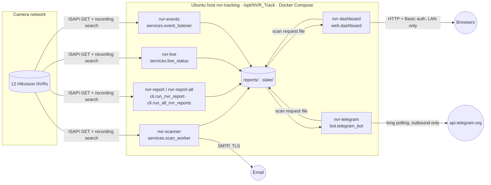

# Architecture

NVR Track is a set of small Python services that share one Docker image and
one code package (`backend/nvr_track`). They talk to each other only through
files in `reports/` and `state/`, never over the network. Only the NVR-facing
services hold NVR credentials, and they only read from the NVRs.

## Services

| Service | Module | Reads | Writes | Secrets |
|---|---|---|---|---|
| nvr-scanner | `nvr_track.services.scan_worker` (runs `cli.run_nvr_report` / `cli.run_all_nvr_reports` as child processes) | inventory, NVRs, `state/notes`, `state/events` | `reports/`, `state/scan`, `state/snapshots` | `.env` (NVR + SMTP) |
| nvr-live | `nvr_track.services.live_status` | inventory, NVRs (2 GETs per check) | `state/live` | `.env` |
| nvr-events | `nvr_track.services.event_listener` | inventory, NVR alert streams (GET) | `state/events` | `.env` |
| nvr-dashboard | `nvr_track.web.dashboard` | `reports/`, `state/*`, `frontend/` | `state/scan/request.json`, `state/notes`, `state/custom_reports` | dashboard login only |
| nvr-telegram | `nvr_track.bot.telegram_bot` | `reports/`, `state/*` | `state/telegram`, `state/notes`, `state/scan/request.json` | Telegram settings only |
| nvr-report, nvr-report-all | `nvr_track.cli.run_nvr_report`, `nvr_track.cli.run_all_nvr_reports` | inventory, NVRs | `reports/`, `state/snapshots` | `.env` |

Healthchecks: `nvr_track.services.healthcheck` (dashboard HTTP, heartbeat files).

## Code map (`backend/nvr_track`)

| Package | What it does | Modules |
|---|---|---|
| `core` | Shared basics | `paths` (project root, frontend folder), `config` (inventory), `report_lock`, `mailer` |
| `nvr` | Read-only ISAPI calls and their parsing | `isapi` (device, channels, status), `storage`, `smart`, `recording` (search), `camera_recording` (per-camera tracks), `historical_recording`, `retention` (calendars), `snapshots` (pictures), `events` (alert stream, event store) |
| `monitoring` | What the results mean over time | `camera_condition`, `live`, `flapping`, `duplicates`, `inventory_changes`, `notes` (known issues, repair log), `uptime` |
| `reports` | Findings and documents | `reporting` (overall status, storage findings), `monthly_pdf`, `custom_reports` (report builder) |
| `web` | Dashboard server | `dashboard` (Basic auth, login lockout, JSON API, static files) |
| `bot` | Telegram | `telegram_bot` (commands, alerts, digest), `telegram_views` (texts) |
| `services` | Long-running entry points | `scan_worker`, `live_status`, `event_listener`, `healthcheck` |
| `cli` | One-shot entry points | `run_nvr_report`, `run_all_nvr_reports`, `uptime_report`, `archive_reports`, `check_inventory`, `probe_nvr_features`, `verify_recording_tracks`, `explain_recording_search`, `inspect_recording_report`; `cli/diagnostics/*` manual one-NVR checks |

Rules of thumb: only `nvr/` talks to NVRs; `web/` and `bot/` never do (they
read saved files and queue scans through `state/scan/request.json`); nothing
under `frontend/` is generated — the pages are plain HTML, CSS and JS.

## Frontend

`frontend/<page>/index.html` loads `/static/<page>/<page>.css` and
`/static/<page>/<page>.js`. The dashboard serves exactly these files from a
fixed list read at start (no path from the URL reaches the disk), behind the
same login as the pages. Content-Security-Policy: `default-src 'none';
script-src 'self'; style-src 'self'; connect-src 'self'; img-src 'self' data:`
— no inline script, style or event handler is allowed, so keep everything in
the `.js` / `.css` files and build the DOM with `textContent`, never
`innerHTML`.

| Route | Answer |
|---|---|
| `GET /` · `GET /reports` | Dashboard · report builder page |
| `GET /static/{dashboard,report-builder}/*.{js,css}` | Page script and style |
| `GET /api/dashboard` · `GET /api/scan` | Saved-report data · scanner status |
| `GET /api/snapshot?nvr=&ch=[&ref=1]` | Stored camera picture |
| `GET /api/report.pdf?period=YYYY-MM` | Monthly PDF |
| `GET /api/custom-reports` · `GET /api/custom-reports/download?id=&format=csv\|pdf` | Report builder options / saved files |
| `POST /api/scan` · `/api/notes` · `/api/custom-reports` | Need header `X-NVR-Track: <last path part>` and a JSON body (CSRF guard) |

## Files and paths

`nvr_track.core.paths.PROJECT_ROOT` is the repository folder: `/opt/NVR_Track`
on the server, `/app` in the containers (code in `/app/backend`, pages in
`/app/frontend`, `PYTHONPATH=/app/backend`). Services run with this folder as
the working directory, so `config/`, `reports/` and `state/` resolve the same
way everywhere.

| Folder | Content | Written by |
|---|---|---|
| `reports/` | `<nvr>_<timestamp>.json` per scan, `fleet_latest_run.json`, `uptime/` CSV, JSON, PDF | scanner, nvr-report |
| `state/scan` | `status.json`, `request.json` (queued scan) | scanner; dashboard and bot queue requests |
| `state/live` | `<nvr>.json`, `service.json` | nvr-live |
| `state/events` | `events.jsonl`, `status.json` | nvr-events |
| `state/snapshots` | `<nvr>/index.json`, thumbnails | scanner |
| `state/notes` | known issues and repair log | dashboard, bot |
| `state/telegram` | alert state, digest, limits, heartbeat | bot |
| `state/custom_reports` | saved report-builder reports | dashboard |

## Module map (before November 2026)

The code moved from `app/` and `scripts/` into `backend/nvr_track/` without
behaviour changes. Use the new names in commands, e.g.
`python -m nvr_track.cli.uptime_report`.

| Before | Now |
|---|---|
| `app.camera_condition` | `nvr_track.monitoring.camera_condition` |
| `app.camera_recording` | `nvr_track.nvr.camera_recording` |
| `app.config` | `nvr_track.core.config` |
| `app.custom_reports` | `nvr_track.reports.custom_reports` |
| `app.dashboard` | `nvr_track.web.dashboard` |
| `app.duplicates` | `nvr_track.monitoring.duplicates` |
| `app.events` | `nvr_track.nvr.events` |
| `app.flapping` | `nvr_track.monitoring.flapping` |
| `app.historical_recording` | `nvr_track.nvr.historical_recording` |
| `app.inventory_changes` | `nvr_track.monitoring.inventory_changes` |
| `app.isapi` | `nvr_track.nvr.isapi` |
| `app.live` | `nvr_track.monitoring.live` |
| `app.mailer` | `nvr_track.core.mailer` |
| `app.main` | `nvr_track.cli.check_inventory` |
| `app.monthly_pdf` | `nvr_track.reports.monthly_pdf` |
| `app.notes` | `nvr_track.monitoring.notes` |
| `app.recording` | `nvr_track.nvr.recording` |
| `app.report_lock` | `nvr_track.core.report_lock` |
| `app.reporting` | `nvr_track.reports.reporting` |
| `app.retention` | `nvr_track.nvr.retention` |
| `app.smart` | `nvr_track.nvr.smart` |
| `app.snapshots` | `nvr_track.nvr.snapshots` |
| `app.storage` | `nvr_track.nvr.storage` |
| `app.telegram_views` | `nvr_track.bot.telegram_views` |
| `app.uptime` | `nvr_track.monitoring.uptime` |
| `scripts.archive_reports` | `nvr_track.cli.archive_reports` |
| `scripts.diagnose_recording_time` | `nvr_track.cli.diagnostics.diagnose_recording_time` |
| `scripts.event_listener` | `nvr_track.services.event_listener` |
| `scripts.explain_recording_search` | `nvr_track.cli.explain_recording_search` |
| `scripts.healthcheck` | `nvr_track.services.healthcheck` |
| `scripts.inspect_nvr_storage_tracks` | `nvr_track.cli.diagnostics.inspect_nvr_storage_tracks` |
| `scripts.inspect_recording_report` | `nvr_track.cli.inspect_recording_report` |
| `scripts.live_status` | `nvr_track.services.live_status` |
| `scripts.probe_nvr_features` | `nvr_track.cli.probe_nvr_features` |
| `scripts.probe_storage_recording` | `nvr_track.cli.diagnostics.probe_storage_recording` |
| `scripts.run_all_nvr_reports` | `nvr_track.cli.run_all_nvr_reports` |
| `scripts.run_nvr_report` | `nvr_track.cli.run_nvr_report` |
| `scripts.scan_worker` | `nvr_track.services.scan_worker` |
| `scripts.telegram_bot` | `nvr_track.bot.telegram_bot` |
| `scripts.test_channels` | `nvr_track.cli.diagnostics.check_channels` |
| `scripts.test_isapi` | `nvr_track.cli.diagnostics.check_isapi` |
| `scripts.test_recording_search` | `nvr_track.cli.diagnostics.check_recording_search` |
| `scripts.test_storage` | `nvr_track.cli.diagnostics.check_storage` |
| `scripts.uptime_report` | `nvr_track.cli.uptime_report` |
| `scripts.verify_recording_tracks` | `nvr_track.cli.verify_recording_tracks` |
| `app/dashboard_ui.html` | `frontend/dashboard/` (index.html, dashboard.css, dashboard.js) |
| `app/report_builder.html` | `frontend/report-builder/` (index.html, report-builder.css, report-builder.js) |
| `tests/` | `backend/tests/` |
| `requirements*.txt` | `backend/requirements*.txt` |
| `Dockerfile` | `deploy/Dockerfile` |
| `README.md` (long) | `docs/operations.md` |
